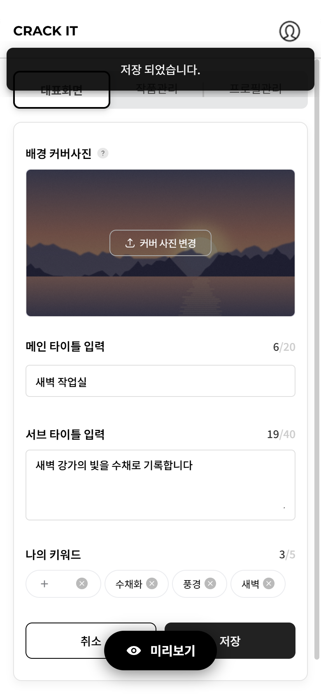
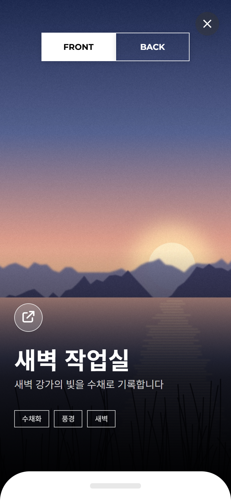
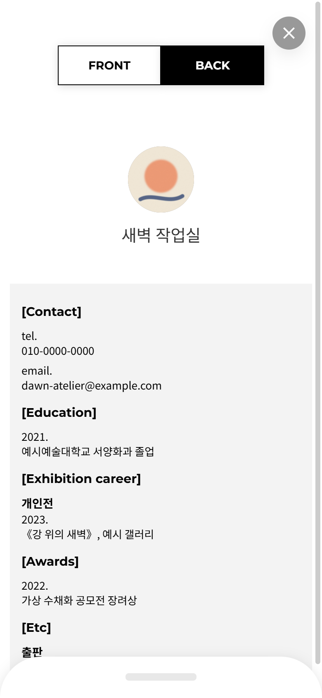
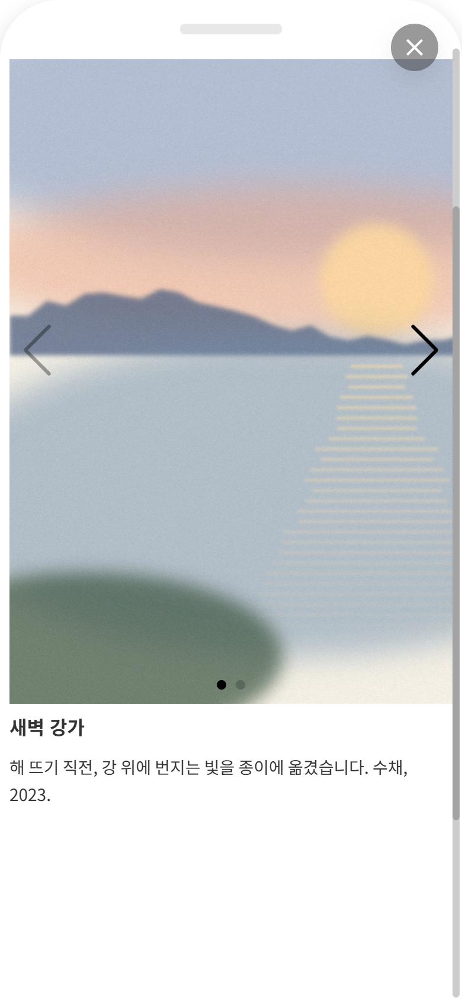

# 포트폴리오 카드 — 프론트엔드 (Angular 14)

포트폴리오 공유 서비스의 클라이언트다. 작가가 대표화면·작품·이력을 입력하면 URL 하나와 QR 코드로 앞면·뒷면 카드 형태의 포트폴리오를 공유할 수 있다.

| 항목 | 내용 |
|---|---|
| 역할 | 프론트엔드 개발 |
| 기간 | 2023-01 – 2023-12 (짝을 이루는 API 서버 저장소의 커밋 기간 기준. 이 저장소 소스의 마지막 수정은 2023-12-28) |
| 스택 | Angular 14.3 · Angular Material/CDK 14.2 · RxJS 7.5 · TypeScript 4.7 |
| 규모 | 손코드 264파일 / 약 14.3k줄 (ts 8,940 · html 2,750 · scss 2,651줄, 개발용 `pages/develop` 제외) |
| 구성 | 라우트 11 · 컴포넌트 79 · NgModule 7 · API 클라이언트 18 · 응답 모델 18 · 공용 UI 컴포넌트 26 |
| 서버 | 별도 저장소의 REST API. 이 저장소만으로는 목업 모드로 실행한다([MOCK.md](MOCK.md)) |

## 기능

- 가입(희망 URL 선점·아이디 중복 확인)과 로그인
- 에디터 3탭
  - 대표화면: 커버 이미지, 메인·서브 타이틀, 키워드(최대 5개)
  - 작품: 작품 블록마다 사진(최대 10장)·제목·본문, 블록 메뉴(바텀시트)
  - 프로필: 기본정보·연락처와 이력 4영역(학력·전시·수상·기타). 전시는 종류 → 연도 → 내용의 3계층 입력
- 공개 카드: 앞면(커버·태그·공유 버튼) ↔ 뒷면(프로필·이력), 끌어 올리는 작품 패널(사진 슬라이더), 공유 링크 복사·QR 코드
- 업로드 전 클라이언트 이미지 압축(커버·프로필 사진, `browser-image-compression`)

## 스택

`package.json` 선언 범위다.

| 구분 | 패키지 |
|---|---|
| 프레임워크 | Angular 14.3(`@angular/core ^14.3.0`) · CLI 14.2 · Angular Material·CDK 14.2 · RxJS 7.5 · TypeScript 4.7 |
| UI | `swiper` 9(작품 슬라이더), `cupertino-pane`(작품 패널), CDK drag-drop, `overlayscrollbars`, `ngx-lottie`(로딩), `angularx-qrcode`(공유 QR), `autosize` |
| 기타 | `browser-image-compression`(업로드 전 압축), `crypto-js`(sessionStorage 암호화) |
| 배포 설정 | `package.json` 의 S3 + CloudFront 스크립트와 `angular.json`·`firebase.json` 의 Firebase Hosting 설정이 함께 있다. 어느 쪽을 운영에 썼는지는 기록이 없다 |

## 구조

```
src/
├─ environments/         # API 주소·sessionStorage 암호화 키 (공개본은 자리표시자)
├─ app/
│  ├─ interceptor/       # HTTP 인터셉터(통과형)
│  ├─ guard/             # 로그인 여부 가드 2종
│  ├─ service/           # crypto · storage(sessionStorage) · loading · feedback · bottom-sheet · file-compress · handle.error
│  ├─ repository/
│  │  ├─ api/            # API 클라이언트 18 (엔드포인트당 메서드, 오류는 handleError 한 곳으로)
│  │  └─ entities/       # 응답 모델 18
│  ├─ components/        # 공용 UI(shared) 26 · 화면 조각(page-parts) · 다이얼로그(template)
│  └─ pages/             # main(홈·로그인·가입) · editor(3탭) · preview(공개 카드) · account · 약관 · develop(개발용)
└─ _mock/                # 2026년 추가: API 서버 없이 실행하는 목업 층
```

## 실행 (목업 모드)

API 서버·외부 서비스 없이 로컬에서 실행한다. 원본 코드는 그대로 두고 `src/_mock/` 의 목업 층을 `--configuration=mock` 으로 붙인다. 자세한 내용은 [MOCK.md](MOCK.md)에 있다.

```bash
# Node 16.20.2 (.nvmrc)
npm ci
npx ng serve --configuration=mock   # http://localhost:4210
```

- 시드 계정 `sample-artist` / `sample1234`, 공개 카드 `/sample-artist`·`/moonlit-studio`
- MOCK.md 가 말하는 `portfolio/mock` 브랜치는 이 공개본의 `main` 이다.

## 알려진 한계 (원본 그대로 두었다)

- **인증이 클라이언트 전용이다.** 가드는 sessionStorage 에 로그인 정보가 있는지만 보고, 인터셉터의 `Authorization` 헤더 코드는 주석 처리돼 있다. 서버가 돌려준 로그인 정보(비밀번호 포함)를 번들에 든 키로 AES 암호화해 sessionStorage 에 둔다.
- **미완성 기능 6개.** 비밀번호 찾기·비밀번호 변경·회원 탈퇴는 서버를 호출하지 않고 완료 문구만 띄운다. 공개/비공개 토글(작품 블록·이력 영역)과 작품 블록 드래그 정렬은 저장되지 않고, SNS·링크 블록은 주석 처리돼 화면에 없다.
- **테스트가 없다.** spec 0개이고 lint 설정과 CI 도 없다.

## 히스토리

원본 git 이 남아 있지 않아 히스토리는 2026년 원본 스냅샷에서 시작한다. chore(mock) 커밋과 이 README·docs/ 는 2026년에 포트폴리오용으로 추가했다.

| 커밋 | 내용 |
|---|---|
| `ea3aba5` chore: 원본 스냅샷 | 원본 폴더의 소스 그대로(파일 시각 2023-09-12 – 2023-12-28). `.gitignore` 만 스냅샷 전에 보강 |
| chore(mock) 4개 (마지막 `424d3fe`) | `.nvmrc` · `package-lock.json` 추적 · 목업 층 · 목업 fixture 보강 |
| docs 3개 | `MOCK.md` 공개본 정정 · 이 README · `docs/` |

## 공개본에서 바꾼 것

- 식별자·키는 전 히스토리에서 자리표시자(`REDACTED_*`)로 바꿨다: GTM container ID, 운영 API 호스트, sessionStorage 암호화 키(`cryptoPlainText`), `package.json` 배포 스크립트의 S3 버킷·AWS CLI 프로필·CloudFront 배포 ID, 개발용 화면의 외부 이미지 URL·테스트 비밀번호, JSDoc 예시의 계정 ID. 그래서 배포 스크립트와 production 빌드는 원래 대상에 닿지 않는다.
- 회사 정보(대표자명·사업자등록번호·전화·이메일)는 `***` 형태로 가렸다. 상호와 로고 표기는 남겼다. 가입 화면 이메일 예시와 JSDoc 예시 이메일은 `example.com` 주소로 바꿨다.
- 목업 모드는 이 변경과 무관하게 동작한다(API 주소·암호화 키를 목업 environment 가 대신한다).

## 화면 (목업 모드 캡처)

`docs/screens/` 에 46장(23화면 × 1440·390 폭)과 흐름 녹화 1개가 있다. 회사 정보는 촬영할 때 화면에서 "(가림)"으로 가렸고, 미완성 기능에는 배지를 붙였다.

<p>
  
  
  
  
</p>

| 화면 | 1440 | 390 |
|---|---|---|
| 홈 — 희망 주소 입력 | [01-a](docs/screens/01-a-home-1440.png) | [01-a](docs/screens/01-a-home-390.png) |
| 가입 — 아이디 중복 확인 | [01-b](docs/screens/01-b-sign-up-1440.png) | [01-b](docs/screens/01-b-sign-up-390.png) |
| 대표화면 편집 — 커버 업로드·타이틀·키워드 | [01-c](docs/screens/01-c-editor-main-view-1440.png) | [01-c](docs/screens/01-c-editor-main-view-390.png) |
| 작품 편집 — 사진 2장·제목·본문 | [01-d](docs/screens/01-d-editor-art-work-1440.png) | [01-d](docs/screens/01-d-editor-art-work-390.png) |
| 프로필 편집 — 기본정보·연락처 | [01-e](docs/screens/01-e-editor-profile-1440.png) | [01-e](docs/screens/01-e-editor-profile-390.png) |
| 프로필 편집 — 전시 경력 블록 | [01-f](docs/screens/01-f-editor-profile-history-1440.png) | [01-f](docs/screens/01-f-editor-profile-history-390.png) |
| 공개 카드 앞면 | [01-g](docs/screens/01-g-preview-front-1440.png) | [01-g](docs/screens/01-g-preview-front-390.png) |
| 공유 다이얼로그 — QR·링크 | [01-h](docs/screens/01-h-share-dialog-1440.png) | [01-h](docs/screens/01-h-share-dialog-390.png) |
| 공개 카드 뒷면 — 프로필·연락처·학력 | [01-i](docs/screens/01-i-preview-back-1440.png) | [01-i](docs/screens/01-i-preview-back-390.png) |
| 공개 카드 뒷면 — 전시·수상·기타 | [01-j](docs/screens/01-j-preview-back-history-1440.png) | [01-j](docs/screens/01-j-preview-back-history-390.png) |
| 작품 패널 — 사진 슬라이더 | [01-k](docs/screens/01-k-preview-artwork-1440.png) | [01-k](docs/screens/01-k-preview-artwork-390.png) |
| 로그인 실패 토스트 | [02](docs/screens/02-login-failed-1440.png) | [02](docs/screens/02-login-failed-390.png) |
| 작품 편집 — 블록 목록(시드 작가) | [03-a](docs/screens/03-a-editor-art-work-1440.png) | [03-a](docs/screens/03-a-editor-art-work-390.png) |
| 작품 블록 메뉴 — 바텀시트 | [03-b](docs/screens/03-b-art-work-bottom-sheet-1440.png) | [03-b](docs/screens/03-b-art-work-bottom-sheet-390.png) |
| 전시 경력 3계층 입력 | [04-a](docs/screens/04-a-editor-profile-exhibition-1440.png) | [04-a](docs/screens/04-a-editor-profile-exhibition-390.png) |
| 삭제 확인 다이얼로그 | [04-b](docs/screens/04-b-profile-delete-confirm-1440.png) | [04-b](docs/screens/04-b-profile-delete-confirm-390.png) |
| 가입 입력 검증 | [05](docs/screens/05-sign-up-validation-1440.png) | [05](docs/screens/05-sign-up-validation-390.png) |
| 시드 작가 카드 — 앞면 | [06-a](docs/screens/06-a-preview-front-1440.png) | [06-a](docs/screens/06-a-preview-front-390.png) |
| 시드 작가 카드 — 뒷면 위 | [06-b](docs/screens/06-b-preview-back-1440.png) | [06-b](docs/screens/06-b-preview-back-390.png) |
| 시드 작가 카드 — 뒷면 아래 | [06-c](docs/screens/06-c-preview-back-history-1440.png) | [06-c](docs/screens/06-c-preview-back-history-390.png) |
| 시드 작가 카드 — 작품 패널 | [06-d](docs/screens/06-d-preview-artwork-1440.png) | [06-d](docs/screens/06-d-preview-artwork-390.png) |
| 두 번째 시드 작가 — 앞면 | [07-a](docs/screens/07-a-preview-front-moonlit-1440.png) | [07-a](docs/screens/07-a-preview-front-moonlit-390.png) |
| 두 번째 시드 작가 — 뒷면 | [07-b](docs/screens/07-b-preview-back-moonlit-1440.png) | [07-b](docs/screens/07-b-preview-back-moonlit-390.png) |

흐름 녹화: [01-flow-1440.webm](docs/screens/01-flow-1440.webm) — 가입 → 에디터 3탭 → 공개 카드(65.8초, 1440×900).

## 라이선스

All rights reserved — 포트폴리오 열람용
